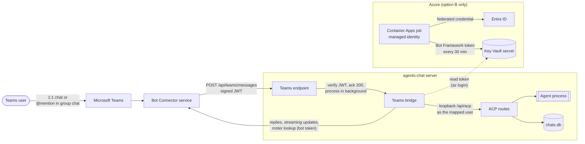

# Microsoft Teams bot

agents-chat can expose one agent as a Microsoft Teams bot. Users message the bot in a 1:1 Teams chat,
or @mention it in a group chat, and the configured agent replies there. Replies stream into Teams as
the agent writes them. The same conversations also appear in the agents-chat web UI.

- [Architecture](#architecture)
- [Commands](#commands)
- [Group chats](#group-chats)
- [Setup](#setup)
- [Option B: Key Vault token (no client secret)](#option-b-key-vault-token-no-client-secret)
- [Security](#security)
- [Performance](#performance)
- [Troubleshooting](#troubleshooting)
- [Limitations](#limitations)

## Architecture



1. The Bot Connector service calls `https://<public-host>/api/teams/messages` with a signed JWT.
   The endpoint verifies it, returns `200` right away, and handles the message in the background.
2. The bridge looks up the sender in the Teams roster and maps them to an agents-chat account by
   **email/UPN**. It then calls the existing `/api/acp` route over loopback as that user. Chat
   ownership, agent access, and the admin role work exactly as in the web UI.
3. Each Teams 1:1 conversation maps to one agents-chat chat named `Teams: …`. In a group chat, each
   person gets their own agents-chat chat. `/new` starts a new one.
4. The bridge polls the turn and streams the growing answer to Teams. Agent questions and
   permission prompts are posted as numbered lists. Reply with the number or label; free-text
   questions take one answer per line.

## Commands

| Command | Effect |
| --- | --- |
| `/new [prompt]` | Start a new chat, optionally with a first prompt |
| `/stop` | Stop the running response |
| `/whoami` | Show the mapped account, agent, model, and chat id |
| `/model [number or name]` | List the agent's models, or switch to one (also changes your model for this agent in the web UI) |
| `/help` | Show help |

Teams turns use the same model as the web UI: the model you last picked for this agent in agents-chat, otherwise the agent's default model.

## Group chats

When the **Group chat** scope is enabled, anyone in the chat can add the bot (chat header → **+** /
**Apps**). To avoid interrupting the discussion:

- The bot acts **only on messages that @mention it**, for example `@agent-xujx summarize the build
  failure`. Everything else is ignored. Teams only delivers @mentions to the bot by default, and the
  bridge also checks the mention itself.
- Commands work the same way: `@agent-xujx /stop`, `@agent-xujx /new`.
- **Each person runs as themselves.** The asker is mapped to their own agents-chat account and gets
  their own chat for that group. Only the asker can answer the agent's questions or `/stop` their
  turn. Replies @mention the asker. To answer a question from the agent, @mention the bot with
  your answer.
- **Replies are visible to everyone in the group chat.** The agent runs with the asker's access, so
  do not ask it for anything the other members should not see.
- Only people listed in `TEAMS_ALLOWED_USERS` get a response. The bot ignores everyone else without
  replying, including members from other organizations and anonymous users.

## Setup

You need:

- A running agents-chat deployment (see the [Windows](deploy-windows.md) or [Linux](deploy-linux.md) guide).
- A public HTTPS URL that reaches it, such as a reverse proxy or a
  [dev tunnel](https://learn.microsoft.com/azure/developer/dev-tunnels/).
- Permission to create apps in the [Teams Developer Portal](https://dev.teams.microsoft.com) and to
  upload custom apps in Teams.

### 1. Create the agent

In the agents-chat **Agents** panel, create a dedicated agent for Teams, for example with id `teams`.
Make it public, or grant access to the users who will use the bot.

### 2. Expose the messaging endpoint

The Bot Connector service must reach `https://<public-host>/api/teams/messages`. With a dev tunnel:

```powershell
devtunnel create agents-chat --allow-anonymous
devtunnel port create agents-chat -p 3000
devtunnel host agents-chat
```

Anonymous tunnel access is required because the Bot Connector service cannot sign in to the
tunnel. The endpoint itself rejects any request without a valid Bot Framework token, and every
other route still requires an agents-chat sign-in. Keep the tunnel host running alongside the service.

### 3. Register the bot

1. In the Developer Portal, open **Tools → Bot management → New bot**. This creates a single-tenant
   Entra app; note its **app (client) id**.
2. Under **Configure**, set the endpoint address to `https://<public-host>/api/teams/messages`.
3. Give the bot a credential:
   - **Option A: client secret.** Under **Client secrets**, add a secret and keep it for
     `TEAMS_BOT_APP_SECRET`.
   - **Option B: Key Vault token.** Use this when your tenant blocks client secrets and
     certificates. Follow [Option B](#option-b-key-vault-token-no-client-secret), then continue here.

### 4. Configure agents-chat

Add these to `.env.local` (`shared/.env.local` for script deployments), then restart the service:

| Variable | Required | Description |
| --- | --- | --- |
| `TEAMS_BOT_APP_ID` | yes | Bot app (client) id |
| `TEAMS_BOT_APP_SECRET` | one of | Option A: bot client secret |
| `TEAMS_BOT_TOKEN_VAULT` | one of | Option B: Key Vault name or URL holding the Bot Framework token |
| `TEAMS_BOT_TOKEN_SECRET` | no | Option B: secret name. Defaults to `teams-bot-token` |
| `TEAMS_TENANT_ID` | yes | Tenant whose users may use the bot |
| `TEAMS_AGENT_ID` | yes | Agent id that answers Teams messages |
| `TEAMS_ALLOWED_USERS` | yes | Comma-separated emails/UPNs allowed to use the bot. Empty means **nobody**: the bot ignores everyone |
| `TEAMS_BOT_AUTH_TENANT` | no | Token tenant for option A. Defaults to `TEAMS_TENANT_ID`; use `botframework.com` for multi-tenant bots |
| `TEAMS_INTERNAL_BASE_URL` | no | Loopback URL of this app. Defaults to `http://127.0.0.1:$PORT` (3000) |

The feature stays off, and the endpoint returns `404`, until the app id, tenant, agent, and one
credential are set. `NEXTAUTH_SECRET` must also be set, as it is for the web UI. Until
`TEAMS_ALLOWED_USERS` lists at least one email, the bot does not reply to anyone.

Check the endpoint: an unsigned request must be rejected with `401`.

```powershell
curl.exe -s -o NUL -w "%{http_code}`n" -X POST https://<public-host>/api/teams/messages -H "Content-Type: application/json" -d "{}"
```

### 5. Create and install the Teams app

1. In the Developer Portal, open **Apps → New app** and fill in the basic information.
2. Under **App features → Bot**, select the bot from step 3 and enable the **Personal** scope.
   Also enable **Group chat** if people should be able to add the bot to group chats
   (see [Group chats](#group-chats)). Do not grant the `ChatMessage.Read.Chat` (RSC) permission;
   the bot does not need it.
3. Use **Preview in Teams**, or **Publish → Download app package** and upload it in Teams through
   **Apps → Manage your apps → Upload an app**. To make it available to others, publish it to your
   organization's app catalog.
4. Open the bot in Teams and send `/whoami`. It should show your agents-chat account.

## Option B: Key Vault token (no client secret)

No long-lived credential is stored anywhere. A scheduled Container Apps job signs in with a
user-assigned managed identity, uses a federated credential on the bot app to mint a Bot Framework
token, and writes it to a Key Vault secret. agents-chat reads the secret with the Azure CLI login of
the account that runs the service.

The job has no ingress, no storage account, and no secrets. The identity can write only that one secret.

Set these PowerShell variables first:

```powershell
$rg = '<resource-group>'; $location = '<region>'; $kv = '<key-vault-name>'
$tenant = '<tenant-id>'; $appId = '<bot-app-id>'
```

1. **Managed identity**

   ```powershell
   az identity create -g $rg -n agent-bot-mi -l $location
   $mi = az identity show -g $rg -n agent-bot-mi | ConvertFrom-Json
   ```

2. **Federated credential on the bot app.** It trusts tokens of that identity only.

   ```powershell
   @{ name = 'agent-bot-mi'; issuer = "https://login.microsoftonline.com/$tenant/v2.0"
      subject = $mi.principalId; audiences = @('api://AzureADTokenExchange') } |
     ConvertTo-Json | Set-Content fic.json
   az ad app federated-credential create --id $appId --parameters fic.json
   Remove-Item fic.json
   ```

3. **Key Vault secret and roles.** The vault must use the RBAC permission model.

   ```powershell
   az keyvault secret set --vault-name $kv -n teams-bot-token --value pending -o none
   $kvId = az keyvault show -n $kv --query id -o tsv
   # The job identity can write this one secret only
   az role assignment create --role 'Key Vault Secrets Officer' --assignee-object-id $mi.principalId `
     --assignee-principal-type ServicePrincipal --scope "$kvId/secrets/teams-bot-token"
   # The account that runs agents-chat can read it
   az role assignment create --role 'Key Vault Secrets User' --assignee '<service-account-upn>' `
     --scope "$kvId/secrets/teams-bot-token"
   ```

4. **Token job.** Save this script as `token-job.sh`:

   ```bash
   set -euo pipefail
   az login --identity --client-id "$MI_CLIENT_ID" --allow-no-subscriptions -o none
   A=$(az account get-access-token --resource api://AzureADTokenExchange --query accessToken -o tsv)
   R=$(az rest --method post --skip-authorization-header --url "https://login.microsoftonline.com/$TENANT_ID/oauth2/v2.0/token" --headers Content-Type=application/x-www-form-urlencoded --body "client_id=$APP_ID&grant_type=client_credentials&scope=https%3A%2F%2Fapi.botframework.com%2F.default&client_assertion_type=urn%3Aietf%3Aparams%3Aoauth%3Aclient-assertion-type%3Ajwt-bearer&client_assertion=$A" --query "[access_token,expires_in]" -o tsv)
   TOK=$(echo "$R" | sed -n 1p); EXP=$(echo "$R" | sed -n 2p)
   EXPAT=$(date -u -d "+${EXP} seconds" +%Y-%m-%dT%H:%M:%SZ)
   az keyvault secret set --vault-name "$VAULT" -n teams-bot-token --value "$TOK" --content-type application/jwt --tags "expiresAt=$EXPAT" -o none
   echo "token refreshed, expiresAt=$EXPAT"
   ```

   Then create the environment and the job from a JSON spec, which `--yaml` accepts, and run the
   job once. A spec file avoids the quoting problems of passing the script on the command line.

   ```powershell
   az containerapp env create -g $rg -n agent-bot-env -l $location --logs-destination none
   $envId = az containerapp env show -g $rg -n agent-bot-env --query id -o tsv
   $job = @{
     location = $location
     identity = @{ type = 'UserAssigned'; userAssignedIdentities = @{ $mi.id = @{} } }
     properties = @{
       environmentId = $envId
       configuration = @{
         triggerType = 'Schedule'; replicaTimeout = 300; replicaRetryLimit = 2
         scheduleTriggerConfig = @{ cronExpression = '*/30 * * * *'; parallelism = 1; replicaCompletionCount = 1 }
       }
       template = @{ containers = @(@{
         name = 'token'; image = 'mcr.microsoft.com/azure-cli:latest'
         resources = @{ cpu = 0.25; memory = '0.5Gi' }
         command = @('/bin/bash', '-c'); args = @((Get-Content token-job.sh -Raw) -replace "`r", '')
         env = @(
           @{ name = 'MI_CLIENT_ID'; value = $mi.clientId }, @{ name = 'TENANT_ID'; value = $tenant }
           @{ name = 'APP_ID'; value = $appId }, @{ name = 'VAULT'; value = $kv }
         )
       }) }
     }
   }
   $job | ConvertTo-Json -Depth 10 | Set-Content job.json
   az containerapp job create -g $rg -n agent-bot-token --yaml job.json
   az containerapp job start -g $rg -n agent-bot-token
   ```

   After a minute, the secret's `expiresAt` tag should be about 24 hours ahead:
   `az keyvault secret show --vault-name $kv -n teams-bot-token --query tags`.

5. **Server.** Set `TEAMS_BOT_TOKEN_VAULT=<key-vault-name>` and run `az login` as the account that
   runs agents-chat. If the service runs as another account (for example a Scheduled Task user),
   sign in as that account. On an Azure VM, run `az login --identity` instead.

The server caches the token and re-reads the secret every 10 minutes in the background. It rejects
tokens issued for another app or already expired. The job refreshes every 30 minutes and each token
lasts about 24 hours, so a few failed runs cause no outage.

## Security

- **Inbound authentication.** Only tokens issued by the Bot Connector service
  (`iss=https://api.botframework.com`) are accepted. They are verified with the Bot Framework signing
  keys, audience = bot app id, and a 5-minute clock tolerance. Entra ID tokens are rejected: any app
  in a tenant can get one with the bot as audience, so they do not prove the request came from Teams.
- **Request binding.** The token's `serviceurl` claim must match the activity, the tenant must equal
  `TEAMS_TENANT_ID`, the channel must be `msteams`, and only personal and group chats are served.
  Group chat members from other organizations and anonymous users are ignored.
- **Outbound token.** The bot token is only sent to Bot Framework / Teams service hosts on an
  allow-list, never to an arbitrary `serviceUrl`.
- **User identity** comes from a server-to-server roster lookup, not from message content. The bridge
  acts with that user's normal agents-chat permissions; `ADMIN_EMAILS` decides the admin role exactly
  as in the web UI. Access is deny-by-default: only emails listed in `TEAMS_ALLOWED_USERS` can use
  the bot, in 1:1 and group chats. Everyone else gets no reply at all (no welcome, help, error, or
  "not allowed" message), so the bot does not reveal itself to people who find or add it.
- **Keeping the app private.** Do not use **Publish → Publish to your org** in the Developer Portal;
  install it for yourself with **Preview in Teams** or a custom upload, keep yourself as the only
  owner, and do not share the app package. Teams cannot stop someone who learns the bot app id from
  uploading their own package for it, which is why the allow-list is enforced on the server.
- **Session.** The bridge mints a short-lived (1 hour) NextAuth session token in memory and uses it
  only on the loopback call to `/api/acp`. It is never sent to Teams or written to disk.
- **Credentials.** Option B stores no credential on the server or in Azure. Key Vault holds only the
  short-lived Bot Framework token, and the job identity can write only that secret. If the host has a
  fixed outbound IP, you can also restrict the vault firewall to it.
- **Logs** contain activity metadata and errors, never tokens or message text.

## Performance

Measured with a local harness: real `/api/acp`, real Key Vault and agent, and a simulated
Bot Connector with 250 ms round trips.

| Step | Time |
| --- | --- |
| Endpoint acknowledgement | Immediate; processing runs in the background |
| First "Thinking…" indicator in Teams | ~0.3 s (warm), ~0.5 s for a new user (one roster lookup; then cached and re-checked in the background every hour) |
| Agent cold start (first message after a service restart) | 4–6 s, while the indicator is already shown. After 4 s it changes to "Starting the agent…", and after 20 s to "Still starting the agent…" |
| Agent finished → final message in Teams | ~0.5 s or less (500 ms poll + one Bot Connector call) |
| Streaming updates | At most one every 1.5 s, as Teams requires |
| Bot token and inbound signing keys | Fetched at service start (log line `Teams bot credentials warmed up`) and kept fresh every 5 minutes, so messages do not wait on `az`, Key Vault, or Entra ID |

After the indicator appears, it shows what the agent is doing (thinking, or the current tool)
until the first words of the answer stream in.

## Troubleshooting

| Symptom | Check |
| --- | --- |
| Endpoint returns `404` | A required `TEAMS_*` variable is missing, or the service was not restarted |
| Bot never answers; logs show `Rejected Teams activity` | The messaging endpoint points to another bot app id, or the server clock is off |
| Logs show `keyvault_cli_token_failed` | The service account is not signed in with `az login`, or the sign-in expired |
| Logs show `bot_token_keyvault_failed: 403` | The service account lacks *Key Vault Secrets User* on the secret |
| Logs show `bot_token_keyvault_expired` | The token job is failing. Run `az containerapp job execution list -g <rg> -n agent-bot-token -o table` |
| Bot does not reply at all, not even a welcome | The user is not in `TEAMS_ALLOWED_USERS` (or it is empty), has no email/UPN in the roster (for example a guest), or is outside `TEAMS_TENANT_ID`. Logs show `Ignoring Teams user ...` with the reason. Add the email and restart |
| "agent is not configured" / "do not have access" | Check `TEAMS_AGENT_ID` and the agent's sharing settings |

## Limitations

- 1:1 and group chats only. In team channels the bot only answers an @mention with a short notice.
- In a group chat, Teams allows one streamed reply at a time. If two people ask at once, the second
  reply arrives as a single message instead of streaming.
- Text only. Attachments and Adaptive Cards are not supported yet.
- In-flight turn state is kept in memory. A service restart during a reply ends that reply in Teams,
  but the full answer is still saved and visible in the web UI.
